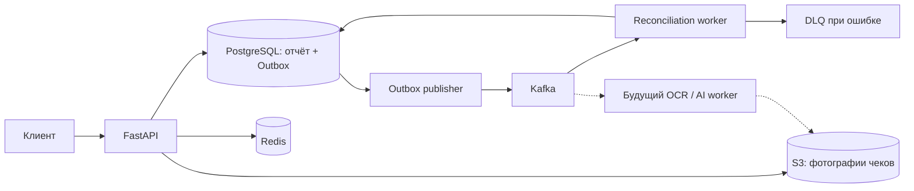

# ShiftLedger

Реализован рабочий backend-каркас для настраиваемых отчётов сотрудников за смену,
учёта расходов с фотографиями чеков и асинхронной сверки показателей.
Архитектура подготовлена для дальнейшего подключения распознавания документов
и ИИ-анализа пояснений сотрудников.

Администратор публикует шаблон с блоками и типизированными полями. Сотрудник
заполняет отчёт и отправляет его с ключом идемпотентности. Отдельный воркер
проверяет баланс кассы и изменение выручки относительно предыдущего дня.
К каждому результату сохраняются исходные показатели проверки.

## Реализованные возможности

- Организации, роли `admin` / `employee`, JWT-аутентификация и Argon2-хеширование паролей.
- Шаблоны с полями `money`, `integer`, `text`, `boolean`, `attachments` и повторяемыми блоками.
- Неизменяемые версии шаблонов и отправленные отчёты; запрет изменения закреплён в PostgreSQL.
- Проверка значений по конкретной версии шаблона, точная арифметика `Decimal` / `NUMERIC`.
- Приватная загрузка JPEG, PNG и WebP: проверка содержимого, размера, числа пикселей и прав доступа.
- Сохранение отчёта и события в одной транзакции через Transactional Outbox.
- Доставка через Kafka, Inbox для повторных сообщений, повторы, DLQ и команда повторной доставки.
- Кэш неизменяемых шаблонов в Redis и атомарное ограничение попыток входа.
- Стартовая миграция Alembic, JSON-логи, request/correlation ID, healthcheck и Prometheus-метрики.
- Docker Compose, закреплённые зависимости и образы, unit/integration-тесты и CI.

В текущей версии выполняется детерминированная сверка. Для ИИ добавлены контракты
`ReceiptExtractor` и `BusinessReviewer`; провайдер ещё не подключён, результат
сверки содержит `ai_status: "not_configured"`.

## Стек

| Компонент | Технология и назначение |
| --- | --- |
| API | Python 3.12, FastAPI, Pydantic |
| Данные | PostgreSQL 18, SQLAlchemy 2 async, asyncpg, Alembic |
| Кэш | Redis 8: cache-aside и ограничение попыток входа |
| События | Apache Kafka 4.3, KRaft, aiokafka |
| Файлы | S3 API через boto3; локально SeaweedFS |
| Наблюдаемость | structlog, Prometheus client, correlation ID |
| Разработка | uv, Ruff, mypy strict, pytest, GitHub Actions |

Точные версии Python-пакетов закреплены в `uv.lock`. Образы инфраструктуры,
Python и uv закреплены digest-значениями.

## Быстрый запуск через Docker Compose

Требуется Docker с Compose и доступными Linux-контейнерами. Для локального стека
рекомендуется выделить Docker не менее 4 ГБ памяти.

PowerShell:

```powershell
Copy-Item .env.example .env
docker compose up -d --build
docker compose run --rm seed
docker compose ps
```

Bash:

```bash
cp .env.example .env
docker compose up -d --build
docker compose run --rm seed
docker compose ps
```

Добавлены отдельные задачи `migrate` и `bootstrap`: сначала применяется миграция,
затем создаются отсутствующие топики Kafka и бакет S3. После их успешного завершения
запускаются API и воркеры. Demo seed выполняется только явной командой, повторный
запуск сохраняет существующие аккаунты и данные.

- Swagger: <http://localhost:18000/docs>
- Проверка готовности: <http://localhost:18000/health/ready>
- Метрики API: <http://localhost:18000/metrics>
- Demo organization: `6d152388-a2cc-4f12-97c3-c935d9c097e0`.

Демо-аккаунты используют пароли из `.env`:

| Роль | Email | Переменная с паролем |
| --- | --- | --- |
| Администратор | `admin@example.com` | `SEED_ADMIN_PASSWORD` |
| Сотрудник | `employee@example.com` | `SEED_EMPLOYEE_PASSWORD` |

Значения из `.env.example` предназначены для локальной разработки. Файл `.env`
исключён из Git и контекста Docker-сборки. Порты инфраструктуры опубликованы
только на `127.0.0.1`: PostgreSQL `15432`, Redis `16379`, Kafka `19092`, S3 `18333`.
API опубликован на `18000`. Порты можно изменить в `.env`.

## Сквозная проверка

Выполняется вход сотрудника, загрузка и скачивание тестового изображения,
отправка двух отчётов, проверка идемпотентности и ожидание результата из Kafka-воркера.
В проверяемом примере фиксируются отклонение кассы `-250.00` и снижение выручки.

Все проверки доступны через Docker, установка Python на хосте не требуется:

```bash
docker compose run --rm --build --no-deps test python scripts/smoke.py --base-url http://api:8000
docker compose run --rm --no-deps test python scripts/check_messaging.py
docker compose run --rm --build test
```

`check_messaging.py` проверяет повторную доставку и попадание некорректного события
в DLQ. Тестовый runner создаёт отдельную БД `shiftledger_test`, применяет миграции
и проверяет соответствие схемы моделям. Integration-тесты очищают только таблицы
этой тестовой БД. Redis для тестов использует отдельную БД `15`.

## Пример API

Вход: `POST /api/v1/auth/login` с JSON:

```json
{"email": "employee@example.com", "password": "пароль из SEED_EMPLOYEE_PASSWORD"}
```

Полученный `access_token` передаётся в `Authorization: Bearer <token>`.
Список шаблонов доступен через
`GET /api/v1/organizations/{organization_id}/templates`, версии — через
`GET /api/v1/organizations/{organization_id}/templates/{template_id}/versions`.

Отправка: `POST /api/v1/organizations/{organization_id}/reports`.
Обязателен заголовок `Idempotency-Key`, например UUID. Пример для демо-шаблона:

```json
{
  "template_version_id": "UUID версии из API или вывода seed",
  "business_date": "2026-10-11",
  "location_code": "main",
  "shift_key": "evening",
  "values": {
    "cash": {
      "opening": "1000.00",
      "sales": "5000.00",
      "refunds": "200.00",
      "collected": "2000.00",
      "closing": "3250.00",
      "revenue": "3500.00"
    },
    "expenses": [{"amount": "300.00", "description": "Упаковка для магазина"}],
    "notes": {"comment": "Покупка оплачена из кассы"}
  }
}
```

Денежные значения передаются десятичными строками; JSON `float` отклоняется.
В демо-шаблоне блок `expenses` обозначает расходы **из кассы**. Безналичные
расходы требуют отдельного поля/блока и соответствующего бизнес-правила.
Для прикрепления чеков сначала выполняется multipart-загрузка в
`POST .../attachments`, затем UUID добавляется в `expenses[].receipts`.

Результат: `GET .../reports/{report_id}/reconciliation` возвращает `202` во время
ожидания и `200` после обработки. Изменение выручки отмечается как сигнал для
проверки контекста. Недостача определяется по балансу ожидаемой и фактической кассы.

## Архитектура



Добавлен модульный монолит с отдельными процессами фоновой обработки.
Доменные правила в `domain.py` не зависят от HTTP, Redis и Kafka.
Прикладные операции находятся в `service.py`, HTTP-слой — в `router.py`,
модели хранения — в `models.py`. Сессии, клиенты и завершение ресурсов
собираются в одной точке через `Resources` и lifespan приложения.

Подробнее: [архитектура и решения](docs/architecture.md),
[разработка и следующие шаги](docs/development.md),
[эксплуатация и восстановление](docs/operations.md).

## Roadmap

### Рабочая основа

- [x] Модульная структура и типизированные границы.
- [x] Docker Compose: API, PostgreSQL, Redis, Kafka, S3, отдельные воркеры.
- [x] Стартовая миграция и ограничения целостности данных.
- [x] JWT, роли и изоляция организаций.
- [x] API шаблонов, типизированных блоков и неизменяемых версий.
- [x] Отправка отчёта, валидация и идемпотентность.
- [x] Приватные фотографии чеков и привязка к расходам отчёта.
- [x] Outbox, Inbox, повторы, DLQ и инструмент повторной доставки.
- [x] Баланс кассы и сравнение выручки с предыдущим бизнес-днём.
- [x] Логи, метрики, healthcheck, тесты и CI-конфигурация.
- [x] Контракты распознавания чеков и ИИ-проверки пояснений.

### Дальнейшее развитие

- [ ] Интерфейс конструктора форм и заполнения отчётов.
- [ ] Справочник торговых точек, назначение сотрудников и расписание смен.
- [ ] Черновики, исправления отдельными ревизиями и журнал действий.
- [ ] OCR / мультимодальное распознавание чеков с отдельным хранением извлечённых данных.
- [ ] Сверка суммы расхода с чеком и поиск повторно приложенных документов.
- [ ] ИИ-агент с доступом к разрешённым инструментам чтения и ссылками на источники.
- [ ] Проверка качества ИИ на наборе размеченных чеков и пояснений.
- [ ] Подтверждение спорных результатов администратором.
- [ ] Правила сверки для разных типов бизнеса, сезонность и сопоставимые смены.
- [ ] Уведомления, общая бизнес-аналитика и экспорт отчётов.
- [ ] Refresh-токены / отзыв сессий и интеграция с внешним identity provider.
- [ ] OpenTelemetry tracing, нагрузочные проверки и автоматизация резервного копирования.

Пункты отмечаются после реализации и проверки соответствующей возможности.

## Использование в production

Добавлены non-root runtime-образ, read-only файловая система контейнеров,
graceful shutdown, закреплённые сборки и проверка конфигурации `APP_ENV=production`.
Локальный Compose содержит один брокер и упрощённые настройки инфраструктуры.
Развёртывание с реальными данными описано в [руководстве эксплуатации](docs/operations.md):
TLS, права БД и S3, секреты, репликация Kafka, резервное копирование и мониторинг.
